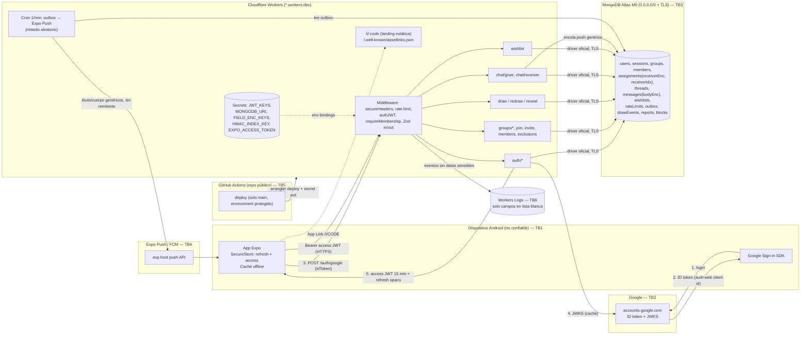

# Modelo de amenazas — Entre Nos (amigo secreto) v1

Fecha: 27 nov 2026 · Autor: seguridad (red team) · Estado: **vinculante para la Fase 2 (API)**.
Alcance: app Expo (Android), API Cloudflare Workers + Hono en `*.workers.dev`, MongoDB Atlas M0, Google Sign-In, Expo Push, GitHub Actions.

Convenciones: **DEBE** = control obligatorio, su ausencia bloquea el merge. **DEBERÍA** = muy recomendado, se puede posponer con un ADR.
Los IDs `T-xx` (amenazas), `C-xx` (controles) y `TEST-xx` (pruebas) se citan en PRs y en el informe de la Fase 4.

---

## 0. Resumen: los 8 controles obligatorios

| # | Control | Mitiga |
|---|---|---|
| C-01 | Toda ruta `/groups/:id/**` pasa por el middleware `requireMembership`: devuelve **404 uniforme** si el usuario no es miembro, y la consulta va **siempre** acotada por `(groupId, userId)` del token, nunca por un id del cliente | IDOR / BOLA, ver asignaciones ajenas |
| C-02 | Las asignaciones solo se leen con `findAssignmentAsGiver(groupId, drawId, me)` y `findThreadAsReceiver(groupId, drawId, me)`. `receiverId` va cifrado (AES-GCM) y el lado receptor usa un índice ciego HMAC. No hay ninguna función que liste las asignaciones de un grupo, salvo `reveal` | Organizador, endpoint con bug o volcado de la BD que muestren asignaciones |
| C-03 | Todas las respuestas pasan por **esquemas Zod de salida `.strict()`** (en lista blanca) y las proyecciones de Mongo también son lista blanca. El lado receptor del chat no tiene ningún campo que identifique al que regala (ni id, ni nombre, ni foto, ni ObjectId) | Desanonimizar el chat, exposición excesiva (API3) |
| C-04 | Canales laterales del chat: ids aleatorios (no ObjectId), sin indicador de escritura ni confirmación de lectura del lado del que regala, `createdAt` redondeado al minuto, push genérico sin contenido enviado por un *outbox* con retardo aleatorio, errores uniformes | Desanonimizar el chat por canal lateral |
| C-05 | Sorteo: derangement **uniforme** con `crypto.getRandomValues` y muestreo por rechazo; transición atómica `open → drawn`; re-sorteo limitado (tope de por vida), notificado a todos y con contador de auditoría visible; exclusiones visibles y acotadas | Manipular el sorteo |
| C-06 | Códigos de invitación de 10 caracteres en Crockford-base32 (50 bits), que vencen y se pueden rotar. Unirse acepta solo `string` con regex (Zod), con tope de 10/min/usuario y de fallos. La página `/i/:code` no consulta la BD | Enumerar códigos, unirse sin invitación, inyección NoSQL |
| C-07 | Autenticación: ID token de Google verificado (`iss`, `aud` ∈ client IDs propios, `exp`, firma JWKS, `email_verified`); el identificador es `sub` y nunca el correo. Access JWT de 15 min con `alg`, `iss`, `aud` y `kid` fijados. Refresh opaco de 256 bits guardado como hash, rotativo y con detección de reutilización que revoca la familia | Robo de cuenta |
| C-08 | Los logs nunca contienen cuerpos, tokens, `receiverId`, texto de chat ni filtros de Mongo: un logger estructurado con campos en lista blanca y un test que captura los logs | Fuga de asignaciones o mensajes por los logs |

---

## 1. Activos, actores, fronteras de confianza y flujo de datos

### 1.1 Activos (por criticidad)

| ID | Activo | Confidencialidad | Integridad | Notas |
|---|---|---|---|---|
| A1 | **Asignación** (quién regala a quién) | **Crítica**: solo la ve el que regala, hasta la revelación | **Crítica** | El corazón del producto |
| A2 | **Identidad del que escribe en el chat anónimo** | **Crítica** | Alta | Se deriva de A1 |
| A3 | Texto de los mensajes del chat | Alta | Alta | ≤ 500 caracteres; 13+; menores posibles |
| A4 | Sesión: access JWT, refresh token, ID token de Google | Alta | Alta | Robo de cuenta = acceso a A1, A2 y A3 |
| A5 | Secretos de servidor: `JWT_KEYS`, `MONGODB_URI`, `FIELD_ENC_KEYS`, `HMAC_INDEX_KEY`, `EXPO_ACCESS_TOKEN` | Crítica | Crítica | Cloudflare secrets y GitHub Secrets |
| A6 | Códigos de invitación | Alta mientras el grupo está abierto | Media | Dan acceso al grupo |
| A7 | Lista de deseos (tallas, enlaces) | Media (dentro del grupo) | Media | |
| A8 | Perfil: nombre, foto, correo, push token | Media (el correo y el push token son altos) | Media | El correo nunca se muestra a otros miembros |
| A9 | Estado del grupo, exclusiones, contador de sorteos | Baja (visible a los miembros) | **Alta** | La integridad importa: es la base de la confianza |
| A10 | Disponibilidad (cuotas gratis de Workers y Atlas) | — | — | 100k req/día; M0 ≈ 100 ops/s y 500 conexiones |

### 1.2 Actores

| Actor | Capacidades | Motivación típica |
|---|---|---|
| **Miembro curioso** | Usuario legítimo con la app; puede usar mitmproxy o una app modificada para llamar a la API a mano | Saber quién le regala, quién le tocó a otro |
| **Organizador** | Miembro con rol `organizer`: exclusiones, sorteo, re-sorteo, revelación, editar el grupo | Ver asignaciones, re-sortear hasta que le salga quien quiere |
| **Externo con cuenta** | Cualquier cuenta de Google; conoce la API (el repo es público) | Entrar a grupos ajenos, enumerar códigos, spam, abuso |
| **Externo sin cuenta** | Internet | DoS (agotar la cuota gratis), sondear la API |
| **Atacante con el teléfono** | Acceso físico a un teléfono desbloqueado o rooteado, o a sus copias de seguridad | Leer la asignación o el chat de la víctima, robar sus tokens |
| **Operador interno** | Desarrollador con Atlas, Cloudflare o GitHub (el propio equipo) | Curiosidad, error humano: un volcado de la BD o un log con datos |
| **Colaborador del repo público** | Abre PRs y forks | Exfiltrar secretos desde CI, cadena de suministro |
| **Terceros** | Google (OIDC), Expo/FCM (push), Cloudflare, MongoDB | Dependencia de confianza; el contenido del push pasa por ellos |

### 1.3 Fronteras de confianza

- **TB1** Dispositivo ↔ API: todo lo que llega del cliente es hostil (la app puede estar modificada).
- **TB2** API ↔ Google (JWKS y tokens): solo es de confianza tras verificar la firma y los claims.
- **TB3** API ↔ MongoDB Atlas: Internet pública (`0.0.0.0/0`), con TLS y credenciales. La BD es de confianza solo para la integridad, **no** para la confidencialidad de A1 y A3 (de ahí C-02).
- **TB4** API ↔ Expo Push ↔ FCM ↔ dispositivo: el contenido del push lo ven terceros y la pantalla de bloqueo.
- **TB5** GitHub Actions ↔ Cloudflare y Atlas: los secretos se inyectan al desplegar; el repo es público.
- **TB6** Logs y observabilidad (Workers Logs, `wrangler tail`): los ve el operador.

### 1.4 Diagrama de flujo de datos



---

## 2. STRIDE por componente

Prioridad: **P0** = bloquea el lanzamiento, **P1** = antes de producción, **P2** = deseable.
Severidad = impacto × probabilidad, ya considerando la motivación de los actores (los miembros curiosos son muchos y muy motivados).

### 2.1 Escenarios priorizados (las amenazas que más importan)

#### T-01 Ver asignaciones ajenas (P0, crítica)
| Vector | Mitigación |
|---|---|
| IDOR: `GET /groups/:id/my-assignment` con un `?userId=` o `giverId` en el cuerpo | El que regala **siempre** es `ctx.userId` (del JWT); los esquemas Zod de entrada son `.strict()` y rechazan claves desconocidas (C-01, C-03) |
| Organizador: la respuesta de `draw` o de `GET /groups/:id` incluye `assignments` | La respuesta del sorteo es `{status, drawNumber, drawnAt}` y nada más; no existe ningún repositorio "listar asignaciones del grupo" fuera de `reveal` (C-02) |
| Revelación anticipada: el organizador adelanta `deliveryDate` a hoy y llama a `reveal` | Después del sorteo, `deliveryDate` solo se puede **atrasar**, o adelantarse a ≥ `now + 48 h`. Revelar exige `now ≥ inicio de deliveryDate (America/Bogota)`, avisa a todos y queda en `drawEvents` |
| Inferencia por el algoritmo (p. ej. "desplazar k posiciones" en orden de ingreso, o ciclo único) | Derangement **uniforme** sobre todas las asignaciones válidas; prueba estadística (TEST-D03). La lista de miembros se ordena por nombre, nunca por el orden del sorteo |
| Volcado de la BD (Atlas abierto a `0.0.0.0/0`, credencial filtrada, operador) | `receiverEnc` = AES-256-GCM(receiverMemberId, AAD = assignmentId); `receiverIdx` = HMAC-SHA256(HMAC_INDEX_KEY, groupId‖drawId‖receiverUserId). Con la BD sola no se reconstruye el grafo (C-02) |
| Orden de inserción o ObjectId de los documentos de asignación (insertados en orden de ciclo) | `_id` aleatorio (UUIDv4); `insertMany` sobre una lista **barajada**; ningún endpoint ordena por `_id` de asignación |
| Logs (`console.log(assignment)`, errores de Mongo con el documento) | C-08 + TEST-L01 |
| Caché HTTP intermedia | `Cache-Control: no-store` en toda la API |
| Teléfono ajeno o copia de seguridad | `android:allowBackup="false"`; caché de asignación y chat fuera de AsyncStorage en claro (ver §5.2); pantalla oculta en recientes (DEBERÍA) |

#### T-02 Desanonimizar el chat (P0, crítica)
El modelo: hay un **hilo por asignación**. El que regala (G) ve "Chat con <Receptor>"; el receptor (R) ve "Tu amigo secreto". El servidor sabe quién es G; el cliente de R **nunca** recibe nada que lo identifique.

| Canal | Ataque | Control obligatorio |
|---|---|---|
| Campos directos | `senderId`, `giverMemberId`, `authorName` o `fromUserId` en el JSON de R | Los mensajes tienen la forma `{id, mine: boolean, body, createdAt}`. No hay campo de autor; `direction` (`g2r`/`r2g`) solo existe en la BD y se traduce a `mine` según el lado del endpoint (C-03, TEST-C01) |
| Ids de mensaje | El ObjectId lleva un valor aleatorio por proceso (5 bytes) y un **contador** (3 bytes). Si G crea un ítem de su lista de deseos y un mensaje en el mismo isolate, R (que ve los ítems de G si ve su lista) correlaciona contadores consecutivos. **Es una fuga real** | **Ningún** id expuesto al cliente es un ObjectId: todo id público es `crypto.randomUUID()` (o 128 bits en base64url). Prueba: TEST-C04 |
| Id de hilo | Si el `threadId` es derivable (hash de giverId) o se comparte entre ambos lados, se puede cotejar | Las rutas no llevan `threadId` (`/chat/giver` y `/chat/receiver` se resuelven por contexto). `threads._id` es aleatorio y nunca se devuelve |
| Orden y secuencia | Una secuencia global (por grupo o por API) revela cuántos mensajes se escribieron en otros hilos entre los míos y en qué orden | Solo `seq` **por hilo**; nada de contadores globales en las respuestas |
| Marca de tiempo | Correlacionar "llegó a las 15:02:17" con quién tenía el teléfono en la mano | `createdAt` al minuto en las respuestas a R; el push sale por un outbox con retardo de 0–3 min al azar (ver T-02b) |
| Contenido del push | El cuerpo del mensaje o el nombre de G en `data` o `body` del push (lo ven Expo, FCM y la pantalla de bloqueo, y lo puede registrar la app) | Push de R: título `Entre Nos`, cuerpo `Tienes un mensaje de tu amigo secreto en «<grupo>»`, `data: {type:"chat", groupId, side:"receiver"}`. **Nunca** texto, autor ni threadId. Prueba: TEST-P01 |
| Indicador de escritura | Saber cuándo G escribe permite correlacionar | **Prohibido en v1** |
| Confirmación de lectura y "en línea" | R ve "leído hace 1 min" → G estaba activo → correlación | **Prohibido en v1** en la dirección G → R. Si algún día se añade, solo G puede ver que R leyó (eso no revela nada de G). "Última conexión" y "en línea": prohibidos en todo el producto |
| Tamaño de la respuesta | Campos opcionales que solo aparecen según quién es G (p. ej. `giverHasPhoto`) | Esquema de salida fijo; nada en la respuesta de R depende de atributos de G salvo el texto que G escribe |
| Diferencias de error | R responde y recibe "tu amigo secreto eliminó su cuenta" o "te bloqueó"; combinado con la lista de miembros ("Usuario eliminado"), lo identifica | Si un miembro sale o borra su cuenta **después** del sorteo, el grupo pasa a `pending_redraw` y **todos** los hilos se cierran a la vez (`409 GROUP_PENDING_REDRAW`, igual para todos). Los errores de `/chat/receiver` salen de un catálogo cerrado e idéntico para cualquier G |
| Tiempo de respuesta | Enviar el push dentro del request es más lento si G tiene push token → oráculo | El push **siempre** va al outbox (insert constante); el envío real lo hace el cron |
| Contadores | "Ana envió 5 mensajes", "mensajes en el grupo: 37", "los más activos" | Prohibidos los contadores por miembro y los totales de chat por grupo visibles para los miembros. Solo se permite "no leídos **en mis** hilos" |
| Bloquear y reportar | R bloquea a G y `GET /blocks` devuelve el `userId` bloqueado; o el bloqueo global hace que G desaparezca en otro grupo compartido | El bloqueo desde un hilo anónimo se guarda **por hilo** (`scope: thread`) y en la respuesta se ve "Amigo secreto · <grupo>". Nunca devuelve el userId. No tiene efectos visibles fuera del hilo |
| Moderación | Expulsar o banear visiblemente a G tras un reporte de R | Las acciones de moderación son diferidas y genéricas; riesgo residual R-04 |
| Notificación de actividad | "Tu amigo secreto vio tu lista de deseos" o "actualizó su lista" enviada a R | Prohibido avisar a R de cualquier acción de G. Lo contrario (avisar a G que R actualizó su lista) sí se permite |
| Metadatos de foto o nombre en los mensajes | Ninguno se envía | — |
| Estilo de escritura o datos que G revela en el texto | Social, fuera de control técnico | Residual R-03 |

**T-02b Cron del outbox** (Cron Triggers, gratis; mínimo cada 1 min): cada fila `outbox` tiene `notBefore = now + random(0..180 s)` para los push hacia R y `now` para los push hacia G. El cron envía las filas con `notBefore ≤ now` en lote, agrupadas por destinatario ("Tienes 3 mensajes nuevos"). Así se rompe la correlación fina y además el request no espera a Expo.

#### T-03 Unirse a un grupo sin invitación (P0, alta)
| Vector | Mitigación |
|---|---|
| Fuerza bruta o enumeración de códigos | 50 bits (10 caracteres Crockford-base32, sin I/L/O/U), generados con `getRandomValues` y muestreo por rechazo. Topes: 10 intentos/min/usuario, 30/día/usuario y 5 fallos/min/usuario; alarma si hay más de 300 fallos/min en total (C-06). Con 10⁴ grupos activos: P(acierto por intento) ≈ 10⁴/2⁵⁰ ≈ 9·10⁻¹² |
| Inyección NoSQL `{"code":{"$ne":null}}` | Zod `code: z.string().regex(/^[0-9A-HJKMNP-TV-Z]{10}$/)` tras normalizar (mayúsculas, quitar guiones y espacios, mapear O→0 e I/L→1). El filtro de Mongo se arma con un string ya validado. Prueba: TEST-J02 |
| Código filtrado (reenviado en WhatsApp a quien no era) | Vencimiento (`inviteExpiresAt`, 14 días por defecto); el organizador puede rotarlo; el código deja de valer al sortear (grupo cerrado); el organizador ve la lista de miembros y puede expulsar antes del sorteo; un expulsado no puede volver con el mismo código (`bannedUserIds`) y expulsar rota el código automáticamente |
| Oráculo por la landing `/i/:code` (muestra el nombre del grupo si el código es válido) | La landing es **estática**: no consulta la BD, no valida el código y no muestra datos del grupo. Solo abre la app o la ficha de Play |
| Oráculo por errores distintos (código inexistente, vencido o rotado) | Los tres devuelven `404 INVITE_INVALID`. Solo con un código **válido** se distingue `409 GROUP_CLOSED` (aceptable) |
| Carrera: unirse mientras se sortea | El sorteo hace una transición atómica de estado y una foto de la membresía; unirse exige `status: "open"` en el mismo `findOneAndUpdate` o en la misma transacción |
| Cuentas Sybil (cuentas extra) | Lista de miembros visible; el organizador expulsa. Residual R-06 |

#### T-04 Manipular el sorteo (P0, alta)
| Vector | Mitigación |
|---|---|
| **Re-sortear hasta que le toque quien quiere** | (a) **Tope de por vida**: `maxRedraws = 3` por grupo, en total y por cualquier motivo (flag de servidor). (b) **Re-sorteo voluntario** (sin cambios de membresía ni de exclusiones): como máximo **1**. (c) Mínimo **1 h** entre sorteos. (d) Cada sorteo o re-sorteo manda push a **todos** y deja un banner permanente en el grupo: "Sorteo #N hecho por <organizador> el <fecha>. Motivo: <motivo>". (e) `drawEvents` (actor, fecha, motivo, número) es legible por todos los miembros. (f) El motivo es obligatorio: `membership_changed` / `exclusions_changed` / `organizer_request` (+ texto ≤ 140, que se muestra a todos) |
| Forzar el resultado con exclusiones (el organizador se excluye de todos menos de su objetivo) | Exclusiones **solo simétricas** (pares). Como máximo `min(3, ⌊(n−1)/3⌋)` por persona. Validación: cada persona debe tener **≥ 2 receptores posibles**, si no `422 EXCLUSIONS_TOO_RESTRICTIVE`. Todos los miembros ven las exclusiones ("Ana ↔ Luis") |
| Bucle de membresía (añade y saca una cuenta propia para justificar re-sorteos) | El tope de por vida (a) cuenta **todos** los re-sorteos; los cambios de membresía también quedan en `drawEvents` |
| Sesgo del PRNG (`Math.random`, módulo con sesgo) | `crypto.getRandomValues` + entero sin sesgo (muestreo por rechazo); regla de lint `no-restricted-properties: Math.random` en `domain` y `api`; TEST-D02 y TEST-D03 |
| Doble sorteo por carrera o repetición | `findOneAndUpdate({_id, status:"open"}, {$set:{status:"drawing"}})` como cerrojo + `Idempotency-Key`; si falla la escritura de asignaciones, se vuelve a `open` |
| Semilla guardada o reproducible | La semilla no se guarda ni se registra en logs; no existe ningún "modo determinista" en producción (los tests inyectan un RNG por parámetro, solo en el paquete `domain`) |
| Miembro no organizador que llama a `draw` | BFLA: `requireRole("organizer")` (TEST-A05) |

#### T-05 Enumerar códigos de grupo e ids (P1, media)
- Los ids públicos (`groupId`, `memberId`, `itemId`, `messageId`) son UUIDv4 aleatorios, no ObjectId (un ObjectId revela la fecha de creación y es semiprevisible).
- `GET /groups/:id` de un no-miembro → **404**, no 403: no confirma que el grupo exista.
- Hay un tope genérico de 404 por usuario (más de 30/min → 429) para frenar el sondeo.

#### T-06 Robo de cuenta (P0, alta)
| Vector | Mitigación |
|---|---|
| ID token de Google emitido para **otra** app (confused deputy) | Verificar `aud` ∈ {WEB_CLIENT_ID} (el `serverClientId` que usa el SDK de Android) y, si viene, `azp` ∈ {ANDROID_CLIENT_ID_debug, ANDROID_CLIENT_ID_release}. También `iss` ∈ {`accounts.google.com`, `https://accounts.google.com`}, `exp` (con 60 s de margen) y `iat`, firma RS256 con la JWKS de Google (caché según `Cache-Control`, refresco si llega un `kid` desconocido, como mucho 1 vez/min), y `email_verified === true` |
| Fusión de cuentas por correo | La identidad es `(provider:"google", sub)`. El correo es solo un atributo y no se usa para enlazar cuentas |
| JWT forjado (`alg:none`, confusión HS/RS, clave débil) | `jose` con `algorithms: ["HS256"]` fijo; `iss = "entrenos-api"`, `aud = "entrenos-app"`, `exp ≤ 15 min`, `kid` obligatorio y conocido; clave de ≥ 32 bytes aleatorios. El `sub` del JWT es el `userId` interno aleatorio |
| Refresh robado | 256 bits aleatorios, guardado como SHA-256 (no hace falta un hash lento porque la entropía es alta); rotación en cada uso; **reutilización detectada → se revoca la familia** (todas las sesiones de ese login). Vence a los 30 días de inactividad y a los 90 en absoluto. El cliente hace refresh *single-flight* (un mutex). El servidor da una gracia de 15 s: si llega el token anterior dentro de ese plazo, responde 401 `REFRESH_RETRY` sin revocar; pasado el plazo, revoca |
| Tokens en almacenamiento inseguro | Solo en SecureStore (`keychainAccessible: WHEN_UNLOCKED_THIS_DEVICE_ONLY`); nunca en AsyncStorage, en logs ni en Redux persistido |
| Tokens en logs o URLs | Solo en la cabecera `Authorization`; nunca en query; el logger redacta `authorization` |
| Push token secuestrado (a la víctima le llegan avisos de otro, o un tercero envía push falsos) | Se activa **Enhanced Push Security** de Expo (se exige `EXPO_ACCESS_TOKEN` para enviar). Al registrar un token que ya existe, se quita del usuario anterior. El token se borra al cerrar sesión |
| Teléfono robado y desbloqueado | Residual R-07; la sesión se cierra desde otro dispositivo (`POST /auth/logout {all:true}`) |
| Borrado de cuenta por quien tiene el teléfono | `DELETE /me` exige un `idToken` de Google **reciente** (`iat` < 5 min) en el cuerpo |

### 2.2 Tabla STRIDE por componente

| Componente | S (suplantación) | T (manipulación) | R (repudio) | I (divulgación) | D (denegación) | E (elevación) |
|---|---|---|---|---|---|---|
| **App móvil** | App modificada que llama a la API como el usuario → toda la autorización está en el servidor | Manipulación de la caché local → el servidor manda | — | Tokens o asignación en una copia de seguridad o en el almacenamiento → SecureStore, `allowBackup=false`, la caché sensible se cifra (§5.2). Lista de deseos con `intent://` o `javascript:` → solo se abre `https:` | — | Deep link `/i/:code` con otros parámetros → solo se acepta el código, validado con regex |
| **auth/** | ID token de otra app → `aud`/`azp` (T-06) | Payload del JWT alterado → firma HS256 con `kid` | Sesiones sin traza → `sessions` con `createdAt`, `lastUsedAt` y familia | Sesión de otro usuario devuelta → la respuesta solo lleva el usuario propio | Inundación de `/auth/google` (verificación RSA, CPU) → 10/min/IP, 5/min por `sub` | Reutilización del refresh → revocar la familia |
| **groups / members / invite** | — | PATCH con `organizerId`, `status`, `premium` o `redrawCount` → asignación masiva; Zod `.strict()` con lista blanca `name, deliveryDate, budget, photo` | Expulsiones sin traza → `drawEvents` y `memberEvents` | Correo o `userId` global de los miembros → solo `memberId` por grupo, nombre y foto | Crear 10k grupos → 10/día/usuario | Miembro que hace de organizador → `requireRole` |
| **join** | — | Inyección NoSQL → Zod | — | Oráculo de códigos → 404 uniforme, landing estática | Fuerza bruta → C-06 | Volver después de una expulsión → `bannedUserIds` + rotación |
| **draw / redraw** | Un no-organizador sortea → BFLA | Sesgo, repetición, re-sorteo ilimitado → T-04 | El organizador niega haber re-sorteado → `drawEvents` visible e inmutable (solo inserción) | La respuesta incluye asignaciones → la salida es solo `{status, drawNumber}` | Sorteo imposible por exclusiones, con bucle de CPU → validar la factibilidad y como máximo 10k intentos de rechazo; n ≤ 30 (gratis ≤ 10) | — |
| **my-assignment** | — | — | — | IDOR → consulta acotada por `ctx.userId` | — | — |
| **chat** | G finge ser otro miembro ("soy Juan") → social; la etiqueta la pone la app | Editar o borrar mensajes ajenos → no hay edición en v1 | Abuso o acoso → reportes que guardan el `giverUserId` en el servidor, solo para moderación | **T-02 completo** | Spam: 20 msg/min/hilo, 200/día/usuario; ≤ 500 caracteres | R escribe en el hilo de otro → los hilos se resuelven por contexto, sin id |
| **wishlist** | — | Editar la lista de otro → PUT solo sobre `mine` | — | Correo o tallas fuera del grupo → solo miembros | Ítems enormes → ≤ 30 ítems, texto ≤ 200, URL ≤ 500 | — |
| **reveal** | Un no-organizador revela → BFLA (salvo el cron) | Adelantar la fecha → T-01 | Revelación sin aviso → push a todos + `drawEvents` | Revelación antes de tiempo = ver todas las asignaciones → depende de la fecha | — | — |
| **push / outbox** | Push falsos a nuestros tokens → Enhanced Push Security | — | — | Contenido en la pantalla de bloqueo o en FCM → genérico | Inundar Expo → por lotes; topes por destinatario | — |
| **MongoDB Atlas** | Credencial robada (`0.0.0.0/0`) → contraseña de 32+ caracteres, un usuario por entorno con privilegio `readWrite@entrenos_<env>`, rotación (§6.4) | Escritura directa → solo el operador; auditoría de Atlas | — | Volcado → cifrado de campo + índice ciego (C-02) | Límites de M0 → índices y un pool de conexiones mínimo | Usuario con `atlasAdmin` en la app → prohibido |
| **Logs** | — | — | Falta trazabilidad → `requestId`, ruta, status, `userId` con hash | Asignaciones o mensajes en logs → C-08 | — | — |
| **CI/CD** | PR de un fork que accede a secretos → nunca `pull_request_target` con checkout del PR; despliegue solo en `push` a `main` con `environment` protegido | Dependencia maliciosa → lockfile, `pnpm audit`, Dependabot, acciones fijadas por SHA | — | Secretos en logs de CI → `::add-mask::`, gitleaks | — | El token de Cloudflare tiene permisos de más → token acotado a "Workers Scripts: Edit" en la cuenta |

---

## 3. Diseño de autorización por endpoint

### 3.1 Reglas globales (middleware, en este orden)

1. `secureHeaders` + `Cache-Control: no-store` + límite de tamaño del cuerpo (64 KB; 48 KB en las rutas con foto).
2. `rateLimit` (§6.1).
3. `authJWT`: obligatorio en todo salvo `POST /auth/google`, `POST /auth/refresh`, `GET /health`, `GET /i/:code` y `/.well-known/*`. Pone `ctx.userId` y `ctx.sid`; si el usuario no existe o está `deleted`, responde 401.
4. `zValidator` de entrada: **`.strict()`**. Las claves desconocidas dan 400, y los ids de ruta deben ser UUID (regex).
5. `requireMembership` en `/groups/:id/**`: `members.findOne({groupId, userId: ctx.userId, status:"active"})`. Si no hay resultado, **404 `NOT_FOUND`**, el mismo cuerpo que un grupo inexistente. Pone `ctx.member` y `ctx.group`.
6. `requireRole("organizer")` donde se indique: un miembro sin el rol recibe **403 `FORBIDDEN`** (ya sabe que el grupo existe).
7. `requireStatus(...)`: la máquina de estados del grupo es `open → drawing → drawn ↔ pending_redraw → revealed → (expireAt)`. Una transición inválida da **409**.
8. Validación de salida: `respond(schema, data)` aplica `schema.strict().parse` en dev y test (falla si sobra algún campo) y `schema.strip().parse` en prod.
9. Errores: forma única `{error:{code, message}}` con un catálogo cerrado. Nunca se incluye `stack`, ni el mensaje de Mongo, ni ids internos.

### 3.2 Matriz

Abreviaturas: **M** = miembro activo del grupo, **O** = organizador del grupo, **U** = cualquier usuario autenticado. Los "Nunca" son también aserciones de test.

| Endpoint | Quién | Chequeo a nivel de objeto y de estado | Devuelve | **Nunca devuelve** |
|---|---|---|---|---|
| `POST /auth/google` | Público (con rate limit) | ID token válido (T-06); upsert por `(google, sub)` | `{accessToken, refreshToken, expiresIn, user:{id,name,photo}}` | El ID token de vuelta, el `sub` de Google, otras sesiones |
| `POST /auth/refresh` | Quien tenga el refresh | `sessions.findOneAndUpdate({tokenHash, revokedAt:null, usedAt:null, expiresAt>now}, {$set:{usedAt:now}})` atómico; si ya estaba usado, aplica la regla de reutilización | Un par nuevo | Información de la familia o de otras sesiones |
| `POST /auth/logout` | U | Revoca la sesión `ctx.sid` (o todas, con `{all:true}`); borra los push tokens de esa sesión | 204 | — |
| `GET /me` | U | `users._id = ctx.userId` | `{id, name, photo, email, createdAt}` | Push tokens, hashes de sesión, `google.sub` |
| `PATCH /me` | U | Lista blanca `name` (1–40, sin caracteres de control ni bidi), `photo` (≤ 40 KB, JPEG/WebP por magic bytes, sin segmento EXIF APP1) | Perfil propio | — |
| `DELETE /me` | U + `idToken` reciente | Borra o anonimiza el usuario; revoca todas las sesiones; en grupos `drawn`, cada uno pasa a `pending_redraw` (para todos a la vez, T-02) y su miembro queda como "Usuario eliminado"; en grupos donde es O y está `open`, se borra el grupo o se exige transferir antes (409 `TRANSFER_REQUIRED`) | 204 | — |
| `PUT /me/push-token` | U | `{token: /^ExponentPushToken\[[A-Za-z0-9_-]+\]$/, platform}`; `updateMany({token}, {$pull})` de otros usuarios y luego se asocia a `ctx.sid` | 204 | — |
| `DELETE /me/push-token` | U | Solo los del propio usuario | 204 | — |
| `POST /groups` | U (10/día) | `name`, `deliveryDate` (en el futuro, ≤ 120 días), `budget` (entero COP ≥ 0, ≤ 10⁸), `photo?`; crea el código; el creador queda como O y miembro | Grupo (vista de O, incluido el código) | — |
| `GET /groups` | U | `members.find({userId: ctx.userId, status:"active"})` → los grupos | `[{id, name, deliveryDate, status, memberCount, myRole, unreadMine}]` | Otros grupos, datos de miembros, cualquier pista de asignación |
| `GET /groups/:id` | M | `requireMembership` | `{id,name,deliveryDate,budget,photo,status,drawNumber,redrawsLeft,drawEvents[],exclusions[] (pares de memberIds), members:[{memberId,name,photo,isOrganizer}] ordenados por name}`; `invite:{code,expiresAt}` **solo si O** | Asignaciones, `userId` global, correos, `lastSeen` o "vio su asignación" por miembro, contadores de chat por miembro, orden de sorteo |
| `PATCH /groups/:id` | O | Lista blanca `name, budget, photo, deliveryDate`. Con `status ≥ drawn`, `deliveryDate` solo puede quedar ≥ `max(actual, now+48h)`; cada cambio avisa a todos | Grupo | — |
| `DELETE /groups/:id` | O | Cualquier estado; push a todos; borra en cascada (asignaciones, hilos, mensajes, listas) | 204 | — |
| `POST /groups/join` | U (C-06) | Zod del código; `groups.findOne({inviteCode, inviteExpiresAt>now})`; `status:"open"`; no está en `bannedUserIds`; capacidad (flag); si ya es miembro, idempotente | `{groupId}` + la vista de M | Si el código no es válido: nada más que `404 INVITE_INVALID` |
| `POST /groups/:id/invite` (rotar) | O (10/día) | `status:"open"` | `{code, expiresAt}` | — |
| `DELETE /groups/:id/members/:memberId` | M si `memberId` = el suyo (salir), O para otros (expulsar) | O no puede salir sin transferir (409). En `open`: se elimina y, si fue expulsión, se agrega a `bannedUserIds` y se rota el código. En `drawn`: el grupo pasa a `pending_redraw`, se borran las asignaciones y se cierran los hilos para todos, con push a todos | 204 | Si un no-O intenta expulsar a otro: 403 (sin detalles del objetivo) |
| `PUT /groups/:id/exclusions` | O | `status ∈ {open, pending_redraw}`; pares de `memberId` del grupo; reglas de T-04; validar que el sorteo sea factible | `exclusions[]` | — |
| `POST /groups/:id/draw` | O + `Idempotency-Key` | `status:"open"`, ≥ 3 miembros, factible; cerrojo atómico; inserta asignaciones barajadas con `drawId` nuevo; `drawEvents` += 1; push a todos | `{status:"drawn", drawNumber, drawnAt}` | **Cualquier asignación, incluida la del propio O** |
| `POST /groups/:id/redraw` | O + `Idempotency-Key` + `{reason}` | `status ∈ {drawn, pending_redraw}`; `redrawCount < maxRedraws`; si es voluntario, `voluntaryRedraws < 1`; `now − lastDrawAt ≥ 1h`; borra las asignaciones y los hilos del `drawId` anterior; nuevo `drawId`; push a todos; banner | `{status, drawNumber, redrawsLeft}` | Asignaciones viejas o nuevas |
| `GET /groups/:id/my-assignment` | M | `status ∈ {drawn, revealed}`; `assignments.findOne({groupId, drawId: group.currentDrawId, giverUserId: ctx.userId}, {projection:{receiverEnc:1}})` → descifrar → miembro receptor | `{recipient:{memberId,name,photo}, wishlist:{items[]}, drawNumber}` | **Quién me regala**, otras asignaciones, `assignmentId`, `drawId` interno |
| `GET /groups/:id/wishlist` (la mía) | M | `wishlists.findOne({groupId, userId: ctx.userId})` | `{items:[{id,text,url?,size?}], updatedAt}` | Quién la vio |
| `PUT /groups/:id/wishlist` (la mía) | M | Reemplaza la lista completa; ≤ 30 ítems; `url` solo `https?:` (Zod `url()` + esquema) | La lista | — |
| `GET /groups/:id/members/:memberId/wishlist` | **Cualquier M** (recomendado) | `requireMembership` + `memberId` pertenece al grupo | La lista de ese miembro | Datos del autor más allá de `{memberId,name}` y quién más la consultó |
| `GET /groups/:id/chat/giver` | M (como G) | `status:"drawn"`; hilo = `threads.findOne({groupId, drawId, giverUserId: ctx.userId})` | `{recipient:{memberId,name}, messages:[{id,mine,body,createdAt}], nextCursor}` | Ids de hilo, ObjectIds |
| `POST /groups/:id/chat/giver` | M (como G) | Igual que el anterior + R no bloqueó el hilo (si lo bloqueó, el error es `403 CHAT_BLOCKED`; G conoce a R, así que no hay fuga) + rate limit | `{id, createdAt}` | — |
| `GET /groups/:id/chat/receiver` | M (como R) | `status:"drawn"`; `threads.findOne({groupId, drawId, receiverIdx: HMAC(groupId‖drawId‖ctx.userId)})` | `{messages:[{id,mine,body,createdAt (al minuto)}], nextCursor}` | **`giverUserId`, `giverMemberId`, nombre, foto, `lastSeen`, recibos de lectura, `threadId`, ObjectIds, `seq` global** |
| `POST /groups/:id/chat/receiver` | M (como R) | Igual que el anterior; los errores salen del catálogo uniforme (§2.1 T-02) | `{id, createdAt}` | Cualquier estado de G (bloqueó, eliminado, sin push) |
| `POST /groups/:id/reveal` | O, o el cron (día siguiente a la entrega) | `status:"drawn"`; `now ≥ inicio de deliveryDate` en America/Bogota; idempotente; push a todos | `{status:"revealed", revealedAt}` | — |
| `GET /groups/:id/reveal` | M | `status:"revealed"`; si no, `409 NOT_REVEALED` (igual para todos) | `{pairs:[{giver:{memberId,name,photo}, receiver:{…}}]}` ordenados por `giver.name` | — |
| `POST /reports` | U (10/día) | `{groupId, context: "chat_receiver"\|"chat_giver"\|"member"\|"group", messageId?, memberId?, reason, note?}`; el llamante debe ser M y el mensaje debe estar en **su** hilo; el servidor deduce el usuario reportado | `{reportId}` | El usuario reportado (sobre todo en `chat_receiver`) |
| `POST /blocks` | U | `{groupId, context:"chat_receiver"\|"chat_giver"}` → bloqueo `scope: thread` resuelto por el servidor | `{blockId, label:"Amigo secreto · <grupo>"}` | El `userId` o `memberId` bloqueado en contexto anónimo |

**Decisión sobre la lista de deseos ajena: cualquier miembro puede leerla.** Motivos:
(1) Si solo el que regala pudiera leerla, el 200 frente al 403 sería un oráculo de asignación (aunque solo revelaría la propia, abre la puerta a errores en el futuro).
(2) Si cualquiera la lee, consultarla no distingue al que regala.
(3) Es el comportamiento social esperado ("¿qué talla usa Ana?").
La app muestra la de mi receptor en `my-assignment`. Queda **prohibido** cualquier "visto por" o contador de visitas.

---

## 4. Modelo de datos a prueba de endpoints con bugs

Principio: **que el bug obvio no tenga nada que filtrar.**

```ts
// users
{ _id: uuid, google: { sub }, email, name, photo?, status: "active"|"deleted", createdAt }

// sessions (refresh)
{ _id: uuid, userId, familyId, tokenHash: sha256b64, usedAt?, revokedAt?, createdAt,
  lastUsedAt, expiresAt, absoluteExpiresAt }                       // TTL index on absoluteExpiresAt

// groups
{ _id: uuid, name, organizerUserId, deliveryDate, budget, photo?, status,
  inviteCode, inviteExpiresAt, bannedUserIds: [], currentDrawId?, drawNumber, redrawCount,
  voluntaryRedraws, lastDrawAt?, expireAt }                        // expireAt = deliveryDate + 60d (TTL)

// members
{ _id: uuid /* = memberId público */, groupId, userId, role, status, joinedAt, expireAt }
// unique (groupId, userId)

// assignments  — SIN campo receiverUserId en claro
{ _id: uuid, groupId, drawId, giverUserId,
  receiverEnc: { v: keyVersion, iv, ct },        // AES-256-GCM(receiverMemberId), AAD = _id|groupId|drawId
  receiverIdx: base64(HMAC-SHA256(HMAC_INDEX_KEY, groupId|drawId|receiverUserId)),
  expireAt }
// unique (groupId, drawId, giverUserId); unique (groupId, drawId, receiverIdx)

// threads  — 1:1 con assignment
{ _id: uuid /* nunca sale de la API */, groupId, drawId, giverUserId, receiverIdx,
  blockedByReceiver: bool, blockedByGiver: bool, expireAt }

// messages
{ _id: uuid, threadId, seq /* por hilo */, direction: "g2r"|"r2g",
  bodyEnc: { v, iv, ct },                         // AES-GCM, AAD = threadId|_id
  createdAt, expireAt }
// SIN senderId / giverId: el remitente se deduce de direction + thread, solo en el servidor

// drawEvents (insert-only), outbox, rateLimits, reports, blocks, wishlists
```

Reglas:

1. **Repositorios por rol, no genéricos.** Solo existen `assignmentsRepo.findForGiver(groupId, drawId, userId)`, `threadsRepo.findForGiver(...)`, `threadsRepo.findForReceiver(groupId, drawId, userId)` (calcula el HMAC por dentro), `assignmentsRepo.insertDraw(...)`, `assignmentsRepo.deleteDraw(...)` y `assignmentsRepo.listForReveal(groupId)` (lanza error si `status !== "revealed"`). La colección cruda (`db.collection("assignments")`) **solo** se importa en ese archivo; una regla de lint (`no-restricted-imports` o una prueba de arquitectura con `dependency-cruiser`) lo hace cumplir (TEST-M01).
2. **Proyecciones en lista blanca** en cada `find`; está prohibido `find()` sin `projection` sobre `assignments`, `threads`, `messages` y `users` (prueba de arquitectura con grep en CI).
3. **DTO explícitos**: los documentos nunca se serializan directo (`c.json(doc)` está prohibido; una regla de lint busca `c.json(` con variables cuyo nombre termina en `Doc`). Siempre se pasa por `toXxxDto()` + el esquema Zod de salida.
4. **Ids públicos**: UUIDv4 en todas las colecciones. Nunca se usan ObjectId: ni como `_id` ni en campos expuestos (T-02).
5. **Mensajes** sin campo de autor. `direction` se traduce a `mine` en el DTO según el endpoint (`/giver`: `mine = direction==="g2r"`; `/receiver`: `mine = direction==="r2g"`).
6. **Cifrado de campo** con WebCrypto AES-GCM 256 e IV aleatorio de 12 bytes. `FIELD_ENC_KEYS = {"current":"k2","keys":{"k1":"...","k2":"..."}}` y cada documento guarda `v`. Se aplica a `receiverEnc` (**DEBE**) y a `bodyEnc` del chat (**DEBE**: cuesta poco y protege ante un volcado y ante el operador). Los textos de la lista de deseos van en claro (son visibles para todo el grupo).
7. **Índice ciego** `receiverIdx` con una clave separada (`HMAC_INDEX_KEY`). Rotarla obliga a reindexar; como los datos viven ≤ 60 días, se rota por temporada (§6.4).
8. **Retención**: un índice TTL sobre `expireAt` (deliveryDate + 60 días) en todas las colecciones del grupo. `messages` y `assignments` se borran antes al re-sortear (`deleteDraw`).
9. **Logs**: un logger `log.info(event, {requestId, route, status, ms, userHash})`. `userHash` = HMAC truncado del userId (para correlacionar sin identificar). Prohibido registrar cuerpos, cabeceras `authorization`, objetos de error de Mongo con `errInfo` o `keyValue` (se sanean), `receiverId`, `receiverIdx`, `body` y push tokens. Los errores no controlados registran `err.name` + `err.code` + el stack **sin** el mensaje si viene del driver.
10. **Inserción barajada**: `insertMany(shuffle(assignments))`, de modo que el orden físico no refleja el ciclo.

---

## 5. OWASP API Security Top 10 (2023) y MASVS → controles y pruebas en CI

### 5.1 OWASP API Top 10 2023

| Riesgo | Controles | Pruebas en CI (obligatorias) |
|---|---|---|
| **API1 BOLA** | C-01, repositorios por rol, 404 uniforme | TEST-A01 "IDOR: un miembro del grupo A recibe 404 en cada ruta `/groups/B/**`" (se itera la tabla de rutas de Hono, no una lista a mano); TEST-A02 "my-assignment ignora `?userId=` y `giverId` en query o cuerpo (400 por `.strict()`)"; TEST-A03 "un no-miembro y un grupo inexistente devuelven un cuerpo idéntico byte a byte"; TEST-A04 "un ex miembro (salió o fue expulsado) recibe 404" |
| **API2 Autenticación rota** | C-07 | TEST-AU01 "ID token con `aud` ajeno → 401"; TEST-AU02 "`iss` ajeno, `exp` vencido, firma inválida, `kid` desconocido → 401"; TEST-AU03 "`email_verified=false` → 401"; TEST-AU04 "JWT `alg:none` y JWT HS256 firmado con la clave pública → 401"; TEST-AU05 "access de 16 min → 401"; TEST-AU06 "reutilizar un refresh después de la gracia revoca toda la familia"; TEST-AU07 "dos refresh concurrentes dentro de la gracia → uno da 200 y otro 401 REFRESH_RETRY, sin revocar"; TEST-AU08 "logout invalida el refresh"; TEST-AU09 "mismo `sub` → mismo usuario; mismo correo con otro `sub` → usuario distinto"; TEST-AU10 "DELETE /me sin un idToken reciente → 401" |
| **API3 BOPLA** (exposición excesiva + asignación masiva) | C-03, `.strict()` de entrada y salida | TEST-C01 "**la respuesta GET de chat del receptor nunca contiene en ninguna parte del JSON** el userId, memberId, nombre, correo, foto (base64 y hash), push token ni un `_id` de un documento del que regala" (búsqueda recursiva de cadenas en el JSON serializado **y** en las cabeceras); TEST-C02 lo mismo para POST `/chat/receiver`, para los errores de `/chat/receiver` y para `/blocks` y `/reports` en contexto `chat_receiver`; TEST-A06 "PATCH /groups con `organizerUserId`, `status`, `redrawCount`, `premium` → 400"; TEST-A07 "GET /groups/:id nunca contiene `assignments`, `receiver`, `giver`, `email` ni `userId`"; TEST-A08 "la respuesta del draw no contiene ningún memberId salvo los de `drawEvents`"; TEST-A09 "los esquemas de salida son `.strict()` (meta-test sobre el registro de esquemas)" |
| **API4 Consumo sin límite** | §6.1, límites de cuerpo y foto, paginación (máximo 50 mensajes), n ≤ 30, tope de intentos del sorteo | TEST-R01 "join: el intento 11 en 1 min → 429"; TEST-R02 "6 códigos fallidos en 1 min → 429"; TEST-R03 "21 mensajes en 1 min en un hilo → 429"; TEST-R04 "cuerpo de 65 KB → 413"; TEST-R05 "foto de 41 KB o que no es JPEG/WebP → 400"; TEST-R06 "exclusiones imposibles → 422 en < 50 ms" |
| **API5 BFLA** | `requireRole` | TEST-A05 "un miembro no organizador recibe 403 en: PATCH/DELETE group, invite, exclusions, draw, redraw, reveal POST y DELETE member ajeno" (tabla de rutas anotadas con `meta.role`) |
| **API6 Flujos de negocio sensibles** | T-03, T-04, reveal por fecha | TEST-D04 "redraw voluntario #2 → 409 REDRAW_LIMIT"; TEST-D05 "redraw antes de 1 h → 429"; TEST-D06 "el redraw número `maxRedraws+1` → 409"; TEST-D07 "cada draw o redraw crea un `drawEvent` y encola un push para **cada** miembro"; TEST-D08 "reveal antes de la deliveryDate → 409"; TEST-D09 "PATCH de deliveryDate a una fecha anterior después del sorteo → 422"; TEST-D10 "exclusión no simétrica o más del tope → 422; un miembro con < 2 candidatos → 422"; TEST-J03 "join con el grupo en `drawn` → 409"; TEST-J04 "un expulsado no puede volver con el código viejo ni con el nuevo"; TEST-J05 "código vencido, rotado e inexistente → la misma respuesta 404" |
| **API7 SSRF** | El servidor **no** hace fetch de URLs del usuario (sin vista previa de enlaces en v1); los únicos destinos salientes son constantes (Google JWKS, exp.host, Atlas) | TEST-S01 "grep en CI: `fetch(` solo con URLs constantes desde `config.ts`" |
| **API8 Mala configuración** | Cabeceras (§6.3), sin CORS, errores sin stack, `wrangler.toml` por entorno | TEST-H01 "toda respuesta trae `Cache-Control: no-store`, `X-Content-Type-Options: nosniff` y `Content-Type: application/json`"; TEST-H02 "OPTIONS en cualquier ruta → sin `Access-Control-Allow-Origin`"; TEST-H03 "error 500 forzado → cuerpo `{error:{code:"INTERNAL"}}` sin stack ni mensaje del driver" |
| **API9 Inventario** | OpenAPI generado desde Zod, prefijo `/v1`, staging y prod separados (Atlas en **proyectos distintos**), sin rutas de depuración en prod | TEST-I01 "las rutas registradas coinciden con OpenAPI y con la tabla de autorización (todas tienen `meta.auth` y `meta.role`; si falta alguna, falla)"; TEST-I02 "en `ENV=production` no existe `/debug/*` ni `/seed`" |
| **API10 Consumo inseguro de APIs** | Las respuestas de Google JWKS y Expo se validan con Zod; timeout de 5 s; los errores de Expo (`DeviceNotRegistered`) solo limpian tokens | TEST-E01 "una JWKS malformada no tumba el servicio: se usa la caché o se responde 503 sin aceptar tokens"; TEST-E02 "un recibo de Expo `DeviceNotRegistered` borra el token" |

Pruebas adicionales del dominio, del chat y de los logs:
- TEST-D01 "el sorteo nunca asigna a alguien a sí mismo ni rompe una exclusión (fast-check, 10k casos)".
- TEST-D02 "el RNG del sorteo se construye con `crypto.getRandomValues`; regla de lint `Math.random` prohibido en `packages/domain` y `apps/api`".
- TEST-D03 "**uniformidad**: con n=4 y n=5 sin exclusiones, 200k sorteos; chi-cuadrado sobre las 9 y 44 derangements, p > 0.001. Ninguna estructura fija: la probabilidad de un ciclo de 2 coincide con la teórica".
- TEST-D11 "doble POST draw concurrente → un solo `drawId`".
- TEST-C03 "el cuerpo de `/chat/receiver` tiene el mismo conjunto de claves con G con o sin foto, con o sin push token, bloqueado o no (comparación de forma)".
- TEST-C04 "**ningún id en respuestas de la API coincide con la regex de ObjectId `^[0-9a-f]{24}$`**".
- TEST-C05 "el `createdAt` de los mensajes en `/chat/receiver` tiene segundos y ms = 0".
- TEST-C06 "no hay campos `seq`, `readAt`, `typing`, `lastSeen` ni `online` en los DTO del chat".
- TEST-C07 "un usuario X que es receptor en un hilo y que regala en otro: `/chat/receiver` solo trae mensajes de su hilo como receptor".
- TEST-C08 "tras salir un miembro en `drawn`: tanto `/chat/receiver` como `/chat/giver` dan 409 GROUP_PENDING_REDRAW para **todos** los miembros".
- TEST-C09 "GET /groups y GET /groups/:id no exponen contadores de mensajes por miembro".
- TEST-P01 "**el payload de push** (título, cuerpo, data) de un mensaje hacia R no contiene el texto del mensaje ni identificadores o nombre del que regala; `data` tiene solo las claves `{type, groupId, side}`".
- TEST-P02 "las filas del outbox hacia R tienen `notBefore − createdAt ∈ [0,180] s` y la distribución no es constante".
- TEST-P03 "POST `/chat/receiver` no llama a `fetch` hacia exp.host (solo inserta en el outbox)".
- TEST-L01 "**captura de logs**: se ejecuta el flujo e2e completo (login, grupo, join, sorteo, chat en ambos sentidos, revelación) con un logger espía. Ningún registro contiene el texto de los mensajes, `receiverEnc` o `receiverIdx`, tokens, correos ni el memberId del receptor junto al userId del que regala".
- TEST-M01 "prueba de arquitectura: solo `repos/assignments.ts` y `repos/threads.ts` importan esas colecciones; ningún `find` sin `projection` sobre las colecciones sensibles".
- TEST-M02 "un volcado de la colección `assignments` (documento crudo) no contiene el memberId ni el userId del receptor en claro".
- TEST-J02 "**inyección NoSQL**: `{"code":{"$ne":null}}`, `{"code":{"$regex":".*"}}`, `{"code":["A"]}`, `{"code":"A\u0000"}` y `{"$where":"1"}` → 400 por Zod, y además el contador de rate limit sube".
- TEST-J01 "el generador de códigos produce 10 caracteres del alfabeto Crockford; 100k códigos sin colisiones ni sesgo de carácter (chi-cuadrado)".
- TEST-W01 "una URL de la lista de deseos con `javascript:`, `intent:`, `file:` o `data:` → 400".
- TEST-U01 "un nombre con U+202E (override bidi) o con caracteres de control → 400 o se limpia".

### 5.2 OWASP MASVS v2 (app Android)

| Categoría | Control | Verificación |
|---|---|---|
| **MASVS-STORAGE** | Tokens solo en SecureStore (Keystore). La caché offline sensible (asignación, chat) se guarda **cifrada**: clave aleatoria en SecureStore y datos en MMKV con cifrado o en SQLite cifrado. La caché de datos no sensibles (grupos, listas) puede ir en claro. `android:allowBackup="false"` (plugin de config de Expo). Al cerrar sesión se borran la caché y las claves. Ningún `console.log` con datos en release (`babel-plugin-transform-remove-console`) | Maestro: logout → la caché está vacía; revisión del `AndroidManifest` en CI (grep de `allowBackup="false"`) |
| **MASVS-CRYPTO** | No hay criptografía propia en el cliente, salvo la clave aleatoria de la caché (`expo-crypto` `getRandomBytes`) | Revisión de código |
| **MASVS-AUTH** | Google Sign-In con `serverClientId`; el `nonce` se envía si el SDK lo permite; el refresh es single-flight; ante 401 en el refresh → logout local | Prueba unitaria del interceptor (concurrencia) |
| **MASVS-NETWORK** | Solo HTTPS (`usesCleartextTraffic=false`, network security config sin user CAs en release). **Sin certificate pinning** en v1: el certificado de `workers.dev` rota y lo gestiona Cloudflare; el riesgo queda en R-08 | Grep del manifest en CI; prueba manual con mitmproxy: la release rechaza el CA de usuario |
| **MASVS-PLATFORM** | App Links verificados (`autoVerify`) con `assetlinks.json` (SHA-256 de la firma de Play App Signing); el deep link acepta solo `/i/{code}` validado por regex; sin WebView; los enlaces de la lista de deseos se abren con `Linking` solo si son `https:`, tras confirmar y mostrando el dominio; las notificaciones con contenido genérico (`VISIBILITY_PRIVATE`). DEBERÍA: ocultar en recientes y bloquear capturas (`FLAG_SECURE`) solo en "Mi amigo secreto" y en el chat (activable, porque a la gente le gusta hacer capturas) | Maestro: un deep link con un código malformado no navega; prueba unitaria del validador de URL |
| **MASVS-CODE** | Dependencias fijadas, `pnpm audit` y Dependabot; Hermes y minificación; SDK objetivo actual; validar con Zod también las respuestas de la API en el cliente | CI |
| **MASVS-RESILIENCE** | No prioritario: el servidor no confía en el cliente. Play Integrity queda en el backlog v2 | — |
| **MASVS-PRIVACY** | Minimización: el correo nunca se muestra a otros; borrado a los 60 días (TTL); `DELETE /me` funcional; Data Safety de Play coherente (nombre, correo, foto, mensajes; cifrados en tránsito; borrado posible); 13+; sin SDK de analítica de terceros en v1 | Lista de verificación de la Fase 5 |

---

## 6. Rate limiting, CORS, cabeceras y rotación de secretos

### 6.1 Rate limiting en el plan gratuito de Cloudflare

Lo que **sí** está disponible sin pagar (hay que verificarlo en el spike de la Fase 1 y fijarlo en un ADR):

| Mecanismo | Disponible gratis | Propiedades | Uso |
|---|---|---|---|
| **Workers Rate Limiting binding** (`[[ratelimits]]` en `wrangler.toml`, `env.RL.limit({key})`) | Sí, según la documentación vigente (no tiene cargo aparte) | Contadores **locales por ubicación de Cloudflare**, eventualmente consistentes, con periodo de 10 s o 60 s; muy baratos (no suman latencia de Mongo). **No es exacto ni global** | Primera capa: por IP (`CF-Connecting-IP`) y por `userId`, en todas las rutas |
| **Contadores en MongoDB** (`rateLimits` con `{_id: key|bucket}`, `$inc` + upsert, TTL en `expireAt`) | Sí (Atlas M0) | Exactos y globales; +1 operación de BD (unos ms en la misma región) | **Límites de negocio**: join (intentos y fallos), redraw, invite rotate, reports, crear grupos, chat por día |
| **Durable Objects** (con backend SQLite) | Sí: el plan Free incluye DO SQLite con cuota diaria (aprox. 100k req/día y 5 GB) | Exactos y serializados por clave | **Opcional**. No se usan en v1 para no sumar piezas; son el plan B si los contadores en Mongo suponen demasiada carga en M0 |
| Reglas de rate limiting del WAF | **No** sirven: requieren una zona propia y `*.workers.dev` no lo es | — | — |
| Workers KV | Sí, pero con 1k escrituras/día gratis y consistencia eventual | Inservible para contadores | No usar |

Límites iniciales (en `config.ts`, ajustables):

| Clave | Capa | Límite |
|---|---|---|
| `ip` global | binding | 300/min (hay NAT de operador en Colombia: ser generoso) |
| `user` global | binding | 120/min |
| `POST /auth/google` por IP | binding | 10/min |
| `POST /auth/refresh` por IP | binding | 30/min |
| `POST /groups/join` por usuario | binding + Mongo | 10/min y 30/día |
| join **fallidos** por usuario | Mongo | 5/min y 20/día; global > 300/min → log `ALERT_JOIN_BRUTEFORCE` |
| 404 por usuario en `/groups/:id` | binding | 30/min |
| `POST /groups` por usuario | Mongo | 10/día |
| `POST /groups/:id/invite` | Mongo | 10/día/grupo |
| `POST chat/*` | binding + Mongo | 20/min/hilo y 200/día/usuario |
| `PUT wishlist` | binding | 30/min |
| `POST /reports` | Mongo | 10/día/usuario |
| `redraw` | Mongo (en el documento del grupo, atómico) | reglas de T-04 |

Respuesta: `429 {error:{code:"RATE_LIMITED"}}` + `Retry-After`. La clave del usuario es `userId` del JWT; antes de autenticar se usa la IP.
**Riesgo de cuota**: el plan Free corta al pasar de 100k req/día y el rate limiting **no** protege la cuota (las peticiones bloqueadas también cuentan). Plan de respuesta en R-01.

### 6.2 CORS

- La app nativa no envía `Origin` ni necesita CORS. **No se registra el middleware `cors()`.** Las respuestas no llevan `Access-Control-Allow-*`, así que un navegador no puede leer la API desde otro origen.
- `OPTIONS` → 404 (o 405) sin cabeceras CORS.
- Peticiones con cabecera `Origin` en rutas `/v1/*` → **403** (ningún cliente legítimo la envía; esto frena el uso de la API desde páginas web). Excepción: ninguna en v1. Si se añade una web, se usa una lista blanca exacta.
- La autenticación va solo por `Authorization: Bearer` (no hay cookies), así que el CSRF no aplica.

### 6.3 Cabeceras de seguridad (Hono `secureHeaders` + personalizadas)

```
Content-Type: application/json; charset=utf-8
Cache-Control: no-store
X-Content-Type-Options: nosniff
Content-Security-Policy: default-src 'none'; frame-ancestors 'none'
X-Frame-Options: DENY
Referrer-Policy: no-referrer
Cross-Origin-Resource-Policy: same-origin
Strict-Transport-Security: max-age=31536000; includeSubDomains   (workers.dev ya está en precarga HSTS; inofensivo)
Permissions-Policy: ()
(sin X-Powered-By ni Server propio)
```
La landing `/i/:code` es HTML estático con su propia CSP (`default-src 'none'; style-src 'unsafe-inline'; img-src 'self'`), sin scripts que lean el código. `assetlinks.json` lleva `Content-Type: application/json` y caché pública corta.

### 6.4 Rotación de secretos

Todos los secretos viven en **GitHub Environments** (`staging` y `production`, con revisor obligatorio en `production`) y se aplican con `wrangler secret put` desde un workflow manual (`workflow_dispatch`). Nunca van en `wrangler.toml` ni en el repo; gitleaks corre en CI.

**JWT (`JWT_KEYS`)**, con el formato `{"current":"2026-12a","keys":{"2026-11a":"<b64 32B>","2026-12a":"<b64 32B>"}}`:
1. Generar la clave nueva (`openssl rand -base64 32`) y añadirla a `keys` **sin** cambiar `current`. Desplegar: ahora se verifican las dos.
2. Cambiar `current` a la nueva y desplegar: se firma con la nueva.
3. Pasados ≥ 20 min (más que la vida del access token de 15 min), quitar la vieja y desplegar.
- **Emergencia** (clave filtrada): reemplazar `keys` solo con la nueva en un único despliegue. Todos los access tokens caen y los clientes hacen refresh (el refresh es opaco y no depende de la clave JWT). Si también se sospecha del refresh: `sessions.updateMany({}, {$set:{revokedAt:now}})` → todos vuelven a iniciar sesión con Google.
- Rotación de rutina: cada temporada o cuando un miembro con acceso deje el equipo.

**Atlas (`MONGODB_URI`)**: dos usuarios por entorno que se alternan (`app_prod_a` / `app_prod_b`), con privilegio específico `readWrite@entrenos_prod` (sin `atlasAdmin`, `dbAdmin` ni `readWriteAnyDatabase`), contraseña de 32+ caracteres aleatorios (alfanuméricos, para no lidiar con escapes en la URI). Staging y producción en **proyectos de Atlas distintos** (cada uno con su M0).
1. Crear `app_prod_b` en Atlas con el mismo privilegio.
2. `wrangler secret put MONGODB_URI` con `b` (desde el workflow) y desplegar.
3. Comprobar `GET /health` (que hace ping a la BD) y los errores en los logs durante 10 min.
4. Borrar `app_prod_a` en Atlas.
- Emergencia: hacer lo mismo en ≤ 15 min, revisar en Atlas el *Access History* y los logs de la base, y considerar rotar `FIELD_ENC_KEYS` (aunque el volcado sin claves no revela A1 ni A3).
- Cada 90 días o cuando cambie el equipo. Se activan las alertas de Atlas para inicios de sesión fallidos y conexiones inusuales.

**`FIELD_ENC_KEYS`**: igual que JWT (versión `v` en cada documento). Para rotar se añade la clave nueva como `current`. Los documentos viejos se siguen descifrando con su `v` y vencen solos en ≤ 60 días (TTL); después se retira la vieja. Si hay urgencia, un script de recifrado.
**`HMAC_INDEX_KEY`**: se rota **solo entre temporadas** o ante un incidente. Rotarla exige recalcular `receiverIdx`, lo que se hace con un script que descifra `receiverEnc`, resuelve el userId y recalcula el índice, en una ventana con los chats en solo lectura.
**`EXPO_ACCESS_TOKEN`**: crear uno nuevo en Expo, `secret put`, desplegar y revocar el viejo.
**Cloudflare API token de CI**: limitado a "Workers Scripts: Edit" en la cuenta y, si se puede, con filtro de IP; se rota cada 90 días.

---

## 7. Riesgos residuales (ordenados por severidad)

| # | Riesgo | Severidad | Por qué queda | Tratamiento |
|---|---|---|---|---|
| R-01 | **DoS por cuota**: agotar las 100k req/día de Workers Free (o las ops/s de M0) tumba la app en plena temporada | **Alta** | El rate limiting no evita que la petición cuente; no hay WAF en `workers.dev` | Alertas de uso en Cloudflare; runbook para pasar a Workers Paid (5 USD/mes) en minutos; caché en el cliente; los rechazos (401, 429) se responden **antes** de tocar Mongo |
| R-02 | **El operador con todos los secretos** (Atlas + `FIELD_ENC_KEYS` + `HMAC_INDEX_KEY`) puede reconstruir asignaciones y mensajes | **Media-alta** | Es inherente a un sorteo en el servidor | Mínimos accesos (una sola persona en prod), auditoría de Atlas, ninguna herramienta de administración que descifre, y declararlo en la política de privacidad |
| R-03 | **Desanonimización social o temporal**: estilo de escritura, datos en el texto, correlación con quién tenía el teléfono a la hora del push | **Media** | El redondeo y el retardo solo la reducen | Retardo de 0–3 min; consejo en la interfaz ("no firmes tus mensajes"); aceptado |
| R-04 | **Moderación que revela**: actuar sobre un reporte (expulsar o banear a G) delata a G ante R | **Media** | Cualquier acción visible es una señal | Acciones diferidas, preferir avisos privados a G y, si hace falta expulsar, hacerlo junto con un re-sorteo; documentado en el runbook de moderación |
| R-05 | **El organizador sesga el sorteo dentro de los topes** (1 re-sorteo voluntario + exclusiones legítimas) | **Media-baja** | El producto permite re-sortear | Transparencia total: banner, contador y push; el grupo ve el abuso |
| R-06 | **Sybil o colusión**: cuentas extra del organizador, o miembros que comparten capturas de su asignación | **Media-baja** | Problema social y de identidad (Google permite muchas cuentas) | La lista de miembros es visible y el organizador puede expulsar antes del sorteo; aceptado |
| R-07 | **Teléfono desbloqueado o rooteado**: acceso a la asignación y al chat de esa persona | **Media-baja** | Va más allá del modelo de la app | Caché cifrada, `FLAG_SECURE` opcional, cerrar sesión a distancia |
| R-08 | **Sin certificate pinning**: un MITM con un CA instalado en el sistema (dispositivo administrado o rooteado) | **Baja** | El pinning a `workers.dev` es frágil ante la rotación de Cloudflare | Sin user CAs en release; volver a evaluar con un dominio propio |
| R-09 | **Ventana de 15 min** del access JWT tras un logout o un borrado | **Baja** | Los JWT no se revocan sin consultar la BD | El middleware ya consulta `users.status` (cubre borrado y bloqueo); el logout tiene la ventana residual |
| R-10 | **Contenido del push en terceros** (Expo, FCM) | **Baja** | Va genérico, pero revela que hay actividad y el nombre del grupo | Aceptado; se podría quitar el nombre del grupo si se quiere |
| R-11 | **Repo público**: el atacante conoce el código y las reglas | **Baja** | Decisión de producto (minutos gratis de CI) | La seguridad no depende de ocultar nada; los secretos están fuera del repo; CI endurecida |
| R-12 | **Límites del rate limiting local** (binding por ubicación): un atacante distribuido supera un poco los topes | **Baja** | Consistencia eventual | Los límites críticos (join, redraw) usan Mongo, que es exacto; 50 bits de código hacen inviable la fuerza bruta |

### Criterio de salida para la Fase 4 (endurecimiento)

- Todas las pruebas `TEST-*` de este documento existen y están en verde en CI. Las que marcan **(C-01…C-08)** son requisito para mergear la API.
- La tabla de autorización (§3.2) está implementada como metadatos de ruta (`meta.auth`, `meta.role`, `meta.status`) y TEST-I01 la compara con las rutas reales.
- El red team ejecuta manualmente: IDOR con un cliente modificado, inyección en join, fuerza bruta de códigos, bucle de re-sorteos, revelación anticipada, cotejo de ids y tiempos del chat, inspección del payload de push con un dispositivo propio y revisión de los logs de staging tras un flujo completo. Resultado esperado: 0 hallazgos críticos o altos.
